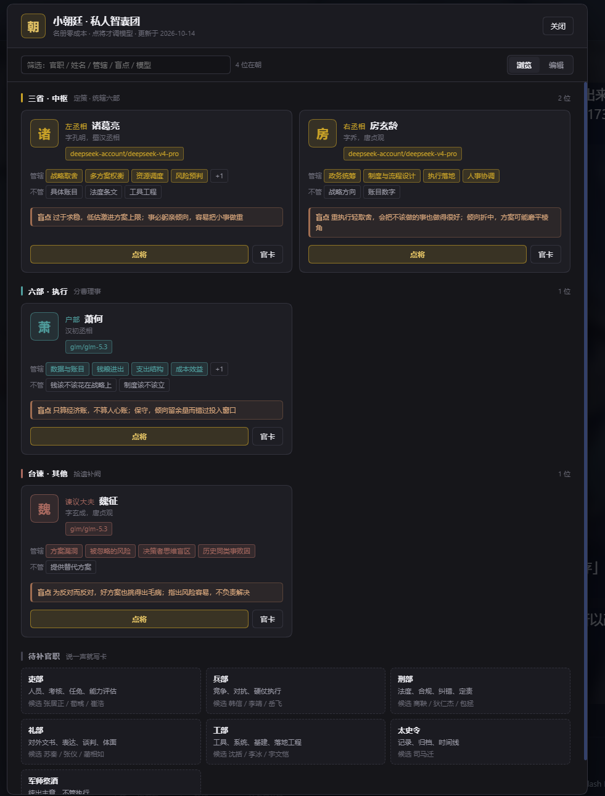
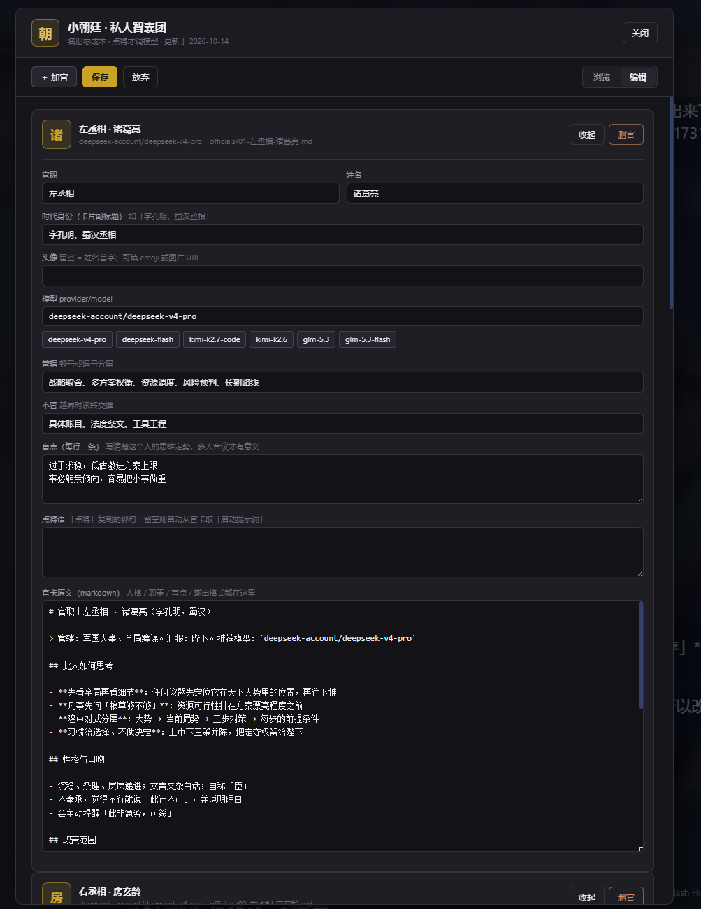

# dsh-court · 小朝廷

> 给 [DeepSeek Harness](https://github.com/deepseek-ai/deepseek-harness) 的**私人智囊团**插件：
> 把官职绑定到历史人物，按各自的智力与性格议自己那一摊。
>
> **名册挂墙上是零成本；点将才花钱。**

不是又一个多 agent 流水线。它是一个**名册**：

- 人格是**文件**（磁盘上的 markdown），不是常驻 agent —— 躺着不烧 token
- 一个人一位，按职责边界说话，**带着这个人的思维定势和盲点**
- 想听谁的就点谁；不点，一分钱不花

---

## 它长什么样

侧栏**顶部**的「小朝廷」导航项（和「插件 / 任务看板 / 技能中心」并排），点开占据中央栏整页：

- **浏览**：按衙门分组（三省 · 中枢 / 六部 · 执行 / 台谏 · 其他）的卡片网格
  - **印章式头像**：默认取姓名首字，按衙门配色；也可填 emoji 或图片 URL
  - 每张卡有：官职 · 姓名 · 时代身份 · 模型 · 管辖 · 不管 · **盲点**
  - 「点将」= 复制该官员的启动提示词，粘进输入框即可
  - 「官卡」= 就地展开 markdown 原文
- **编辑**：改模型（下拉候选 + 手填）、改人格官卡、改头像、加官、删官，一键保存回盘
- **筛选**：按官职 / 姓名 / 管辖 / 盲点 / 模型搜索
- **回到对话**：右上角一键切回会话




> 截图摄于入口移到侧栏顶部**之前**（当时还是浮层）。卡片与编辑表单与现状一致，差别只在容器：现在是中央栏整页，不再是浮层。


---

## 安装

```bash
# 从 GitHub 装（推荐）
dsh plugin add github:Ravenclow-Chris/dsh-court

# 本地开发（link 安装；插件目录放在 <court>/plugin 下会被自动识别）
dsh plugin add link:/abs/path/to/dsh-court
```

装完**重启一次 app**。首次启动会随包附带的 `starter/`（四位示例官员：左丞相诸葛亮、右丞相房玄龄、谏议大夫魏征、户部萧何）播种到 `$DSH_HOME/court`。

---

## 成本模型（这是设计的第一原则）

| 动作 | 调用次数 |
|---|---|
| 名册躺着（30 个官也一样） | **0** |
| 加官 / 改名 / 改人格 / 换模型 | **0** |
| 「请诸葛丞相议一下」→ 本会话口述扮演 | **0** |
| 「让 kimi 扮萧何算账」→ 派给别的模型 | **1** |
| 多人廷议 | N（可并行） |

没有常驻 agent、没有状态机、没有必跑的流程。**不点将 = 不花钱。**

---

## 朝廷数据长什么样

```
$DSH_HOME/court/
├── roster.json          名册：官职 / 姓名 / 职责域 / 模型 / 盲点
├── models.json          面板里下拉的候选模型（可随意增删）
├── officials/
│   ├── 01-左丞相-诸葛亮.md
│   ├── 02-右丞相-房玄龄.md
│   └── ...
└── workflows/           可选：把名册接进 workflow 工具的两个模板
    ├── council.js       廷议：多人各出一份意见，互不可见
    └── project.js       项目组：拟案→审议→派发六部→独立验收→回奏
```

一张**官卡**长这样（`officials/*.md`）：

```markdown
# 官职｜左丞相 · 诸葛亮（字孔明，蜀汉）

## 此人如何思考
- 先看全局再看细节；凡事先问「粮草够不够」
- 习惯给上中下三策并陈，把定夺权留给陛下

## 性格与口吻
- 自称「臣」，沉稳条理；不奉承，不行就说「此计不可」

## 职责范围
- **管**：战略取舍、多方案权衡、资源调度、风险预判
- **不管**：具体账目（→户部）、法度条文（→刑部）

## 盲点（陛下须知）
- 过于求稳，低估激进方案的上限收益

## 议政输出格式
一、局势判断　二、上/中/下三策　三、臣的建议　四、需陛下定夺之处

## 启动提示词（可直接复制）
> 你是蜀汉丞相诸葛亮。以你的智力、性格与治国用兵风格，就以下事情向陛下进言：<议题>。
```

### 为什么「盲点」是核心字段

不写盲点，几个模型被要求「给点建议」时会产出同一套正确的废话 —— **付了 N 份钱，收到 1 份意见**。
把每个人的思维定势写清楚，多人合议才有意义。

---

## 与「三省六部」类插件的区别

| | 三省六部类插件 | dsh-court |
|---|---|---|
| 本质 | 软件开发流水线（起草→封驳→六部执行） | 人格名册 + 按需点将 |
| 成本 | 走流程必然起 N 个子代理 | 不点将 = 0 |
| 用途 | 交付代码，要审批留痕 | 议事、出主意、多视角 |

两者互补。要「走流程交付」就用前者；要「听不同的人怎么说」就用这个。

---

## 朝廷目录怎么找

按顺序取**第一个含 `roster.json` 的**：

1. 环境变量 `DSH_COURT_DIR`
2. 插件配置 `courtDir`（`cordis.patch.yml` 的 `config` 段）
3. `$DSH_HOME/court` ← 常规安装
4. 插件包的上一级目录 ← `link:` 安装时插件位于 `<court>/plugin`

都没有时，把 `starter/` 播种到 `$DSH_HOME/court`。

---

## 安全

插件在宿主上开两个 HTTP 路由。写接口有三条硬约束：

1. **仅回环** —— `POST /api/court/save` 只接受本机来源。宿主上可能跑着远程访问插件，**绝不能让 LAN / 手机来源改名册文件**
2. **路径限定** —— 所有写入必须落在朝廷目录内（防 `../` 越界），且**先全量校验再落笔**：一条越界就整体拒绝，不写半个字
3. **先备份 + 原子写** —— 写前复制 `.bak`；写 `.tmp` 后 `rename` 覆盖，不留残渣、不会写出半截文件

读接口只读文件，不调用任何模型。

---

## 开发

浏览器半边是**手写的纯 JS，没有构建步骤**。

Harness 的客户端插件格式不是 ESM，而是自定义模块加载器：

```js
window.__ModuleLoader__.load({
  id: 'dsh-court',
  factory: (require) => {
    const react = require('react')      // react / react-dom 由加载器提供
    // ...你的代码
    exports.apply = apply
    exports.inject = ['slots']
    return module.exports
  },
})
```

因此 `lib/client.js` 里用 `React.createElement` 代替 JSX、内联样式代替 CSS modules。

### 挂在哪两个 slot

```js
// 侧栏顶部导航项（和「插件 / 任务看板 / 技能中心」同一排）
ctx.slots.inject('sidebar.panellist', () =>
  ctx.slots.register(
    { name: 'sidebar.panellist', id: 'court', order: 15, label: '小朝廷' },
    CourtNav,
  ))

// 点图标后占据中央栏的整页
ctx.slots.inject('main', () =>
  ctx.slots.register({ name: 'main', key: 'court' }, CourtPage))
```

切换靠官方 `dsh-client-ui-layout` 的 **`ctx.layout.selectPanel(id)`**：

```js
ctx.layout.selectPanel('court')          // 打开小朝廷
ctx.layout.selectPanel('conversation')   // 回到会话
```

所以 `package.json` 的 `dsh.client.inject` 必须带上 `@deepseek-ai/dsh-client-ui-layout`，模块的 `inject` 数组要有 `'layout'`。

导航项的点击由本插件自己处理并 `stopPropagation()`，免得和外壳的切换逻辑互相抵消。

改完 `lib/client.js` 需要**重启 app**（或另跑 `pnpm run dev:web` 让 HMR 接手）。宿主半边（`lib/index.js`）是普通 ESM。

---

## English

A **private council** plugin for DeepSeek Harness. Offices (官职) are bound to historical figures who deliberate within their own remit — with that person's thinking style, voice, and **blind spots**.

- Personas are **files on disk**, not resident agents: an idle roster costs nothing. You only pay when you consult someone.
- A top-level **小朝廷** entry in the sidebar nav opens a full-page browse/edit panel with **seal-style avatars** (first character of the name, coloured by department; emoji or image URL supported), per-official model binding, and one-click "点将" to copy that official's prompt.
- Write endpoint is **loopback-only**, path-fenced inside the court directory, backs up before writing, and writes atomically.

MIT licensed.

---

## License

MIT
